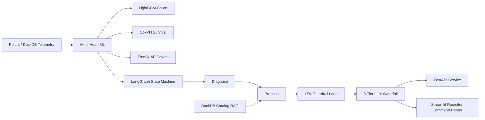

# Autonomous Indian OTT Churn & Retention Agent

An end-to-end portfolio system for autonomous customer engagement and churn
retention on an Indian OTT platform modeled on JioHotstar and SonyLIV.

## Executive Summary

Generic churn models usually answer only “who is likely to leave?”. That is not
enough for Indian OTT economics: the right intervention depends on *why* the
subscriber is leaving and whether the offer is financially viable.

This project turns churn prediction into a governed retention decision. It
combines telemetry, multi-head ML, SHAP explanations, regional catalog RAG,
LangGraph policy routing, deterministic LTV guardrails, and a three-tier copy
generation waterfall.

The policy layer explicitly handles:

- **Paid-Tier Ad Fatigue**: mid-roll abandonment and ad-skip behavior require
  ad-load relief, not a generic content coupon.
- **IPL Post-Tournament Cliffs**: sports-first subscribers need a regional
  thriller/crime bridge after the tournament ends.
- **UPI AutoPay Mandates**: payment failures are involuntary churn and require
  salary-date retries or a sachet-pass bridge.
- **Mobile Sachet Tiers**: one-screen ₹79 subscribers need a multi-screen
  upgrade path when concurrent stream rejections rise.

Every offer must satisfy:

```text
offer_cost_inr <= 0.25 * predicted_remaining_ltv_inr
```

## System Architecture



The runtime flow is:

```text
Telemetry -> ML diagnosis -> archetype policy -> LTV check
          -> downgrade loop when required -> localized retention copy
```

## Benchmark & Calibration Results

The ML calibration metrics are defined in
`src/ml/train_models.py`. Policy results are generated from the 3,000-row,
seed-42 holdout by `src/ml/policy_simulator.py`.

| Metric | Result |
|---|---:|
| ROC-AUC | 0.897 |
| PR-AUC | 0.830 |
| Brier Score | 0.111 |
| Status Quo Net Revenue Retained | ₹7.20L |
| Naive Blanket Discount Net Revenue Retained | ₹7.01L |
| Autonomous Agent Net Revenue Retained | ₹8.98L |
| Discount Leakage Prevented | ₹78,767 |
| Holdout Horizon | 90 days |

The persisted benchmark also includes save rate and net margin for each
canonical churn archetype in
`data/processed/policy_benchmark.json`.

## Repository Layout

```text
data/raw/                 Immutable source CSVs
data/processed/           Parquet, DuckDB, model, persona, and benchmark artifacts
src/data/                 Telemetry synthesis and catalog RAG
src/ml/                   Model training and policy simulation
src/agent/                Pydantic schemas, tools, and LangGraph state machine
src/api/                  FastAPI service
dashboard/                Streamlit recruiter command center
tests/                    Agent and guardrail tests
```

## Quickstart

PowerShell commands from the repository root:

```powershell
# Create or refresh the isolated environment and synchronize dependencies
uv venv .venv
uv sync

# Generate telemetry if the processed parquet is absent
.\.venv\Scripts\python.exe src\data\indian_ott_synthesizer.py

# Train the multi-head ML bundle
.\.venv\Scripts\python.exe src\ml\train_models.py

# Build the offline 90-day policy benchmark
.\.venv\Scripts\python.exe src\ml\policy_simulator.py

# Run the focused test suite
.\.venv\Scripts\pytest.exe -v -s

# Start the API
.\.venv\Scripts\python.exe -m uvicorn src.api.main:app --reload

# Start the recruiter dashboard in a second terminal
.\.venv\Scripts\streamlit.exe run dashboard\app.py
```

API endpoints:

```text
GET  /health
GET  /personas
GET  /personas/random
POST /retain/analyze
GET  /benchmark
```

## LLM Fallback Configuration

Copy `.env.example` to `.env` and set at most the provider configuration you
want to use. The agent falls back automatically:

```text
Cloud LLM -> Local Ollama -> Deterministic Policy Template
```

No API key is required to run the project offline.